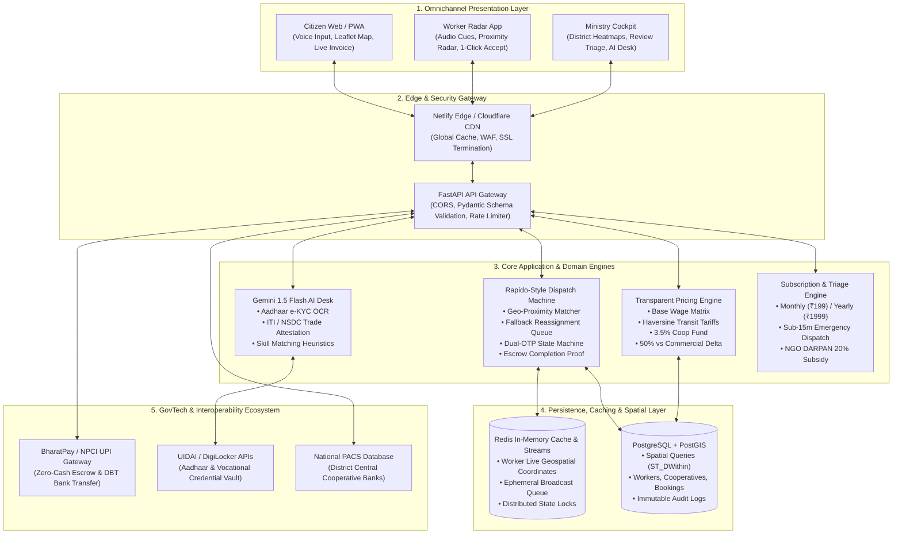

# Seva Setu (सेवा सेतु) — System Design, Architecture & Scaling Strategy
### Implementation Blueprint & 2-Minute Video Pitch Presentation
**Guiding Vision: "Seva Se Samriddhi" (सेवा से समृद्धि) | In Collaboration with Ministry of Cooperation, GoI**

---

## 🎬 2-Minute Video Presentation Framework (120-Second Pitch)

This document serves as the implementation plan and technical architectural brief for **Seva Setu (सेवा सेतु)**, specifically formatted to be presented in a crisp, high-impact **2-minute video presentation** (pitch / architecture review).

```
+---------------------------------------------------------------------------------------------------+
|                                  2-MINUTE TIMELINE BREAKDOWN                                      |
+---------------------+-------------------+---------------------+------------------+----------------+
|  0:00 - 0:20 (20s)  | 0:20 - 0:45 (25s) |  0:45 - 1:15 (30s)  | 1:15 - 1:40 (25s)| 1:40-2:00 (20s)|
|   Hook & Problem    | 3-Portal Ecosystem|   Core Algorithmic  |   Enterprise     | Impact & Vision|
|   Private Monopoly  |   Architecture    |       Engines       |  Scaling Engine  |  Closing Call  |
+---------------------+-------------------+---------------------+------------------+----------------+
```

---

### Beat-by-Beat Video Script & Visual Storyboard

| Timestamp | Visual on Screen | Speaker Script / Voiceover (Concise & Clear) | Technical Keywords |
| :--- | :--- | :--- | :--- |
| **0:00 – 0:20**<br/>*(The Hook & The Crisis)* | Split screen: Private commercial aggregators (25-35% cuts, hidden surge pricing) transitioning into Seva Setu's interface with "100% Wage to Worker" badge. | *"Commercial gig platforms charge citizens exorbitant markups while taking 25 to 35% commission from daily wage workers. Introducing **Seva Setu**, a decentralized cooperative gig infrastructure built under the Ministry of Cooperation's national vision **'Seva Se Samriddhi'**."* | Platform Cooperative, Zero Intermediary Cut, Fair Wage Transparency |
| **0:20 – 0:45**<br/>*(Architecture & 3-Portal Model)* | Animated System Architecture Diagram showing 3 synchronized portals: Citizen App, Worker Radar, and Ministry Cockpit. | *"Our architecture bridges three stakeholders through a unified reactive ecosystem: First, the **Citizen Portal** for transparent, itemized bookings and voice-first triage; Second, the **Worker Radar** offering one-tap job broadcasts and direct passbooks; and Third, the **Ministry Cockpit** for district demand heatmaps and autonomous credential audits."* | Tri-Portal Architecture, Reactive Event Bus, Ministry Telemetry |
| **0:45 – 1:00**<br/>*(The Core Algorithmic Engines)* | UI zooms into the Live Invoice calculation and Rapido-Style Radar with animated candidate reassignments. | *"At the heart of Seva Setu run two core engines: Our **Transparent Pricing Engine** dynamically calculates base labor, toolkit wear, and Haversine transit costs with zero aggregator markup. Our **Rapido-style Dispatch Engine** broadcasts requests within dynamic radii, triggering an automated fallback state machine to reassign jobs if declined."* | Haversine Formula, Dynamic Fare Matrix, Fallback State Machine |
| **1:00 – 1:15**<br/>*(Security, Dual-OTP & AI OCR)* | Screen showcases Dual-OTP timeline (`START_OTP` -> `END_OTP` with photo proof) and Gemini 1.5 Flash Aadhaar/ITI certificate scan. | *"Trust is enforced cryptographically: Dual-OTP guarantees physical arrival and completion proof before escrow release. Furthermore, our **Gemini 1.5 Flash Multimodal OCR** instantly verifies ITI, NSDC, and Aadhaar credentials directly against cooperative registers."* | Dual-OTP Escrow, Multimodal AI OCR, Skill Verification |
| **1:15 – 1:40**<br/>*(Scaling to National Scale)* | Motion graphic showing PostGIS geospatial indexing, Redis queue concurrency, and Cloud Run / Kubernetes auto-scaling. | *"To scale nationally across 100,000+ Primary Agricultural Credit Societies (PACS), we deploy **PostGIS spatial indexing and Uber H3 hexagonal bins** for sub-millisecond proximity queries. Worker broadcasts run over **Redis Streams and WebSockets** with distributed locking to prevent race conditions, supported by an autonomous edge-fallback engine that guarantees 100% offline resilience."* | PostGIS, Uber H3 Hexagons, Redis Streams, WebSockets, Autonomous Edge |
| **1:40 – 2:00**<br/>*(Social Impact & Closing Call)* | Live counter on Ministry Cockpit: ₹4.8M wages disbursed, ₹1.8M citizen savings. Clean closing slide with Government of India crest. | *"By converting gig work into formal cooperative equity, Seva Setu guarantees dignified livelihoods, verifiable trade standards, and unmatched citizen affordability. Seva Setu: Technology empowering grassroots cooperatives. Seva Se Samriddhi!"* | DBT Settlement, Grassroots Empowerment, National Scale |

---

## 🏛️ End-to-End System Architecture



---

## ⚙️ Core Technical Engines & Mathematical Formulations

### 1. Transparent Fair-Wage Pricing Engine (`pricing.py`)
Private aggregators disguise hefty 25–35% platform fees behind dynamic surge multipliers. Seva Setu enforces **100% mathematical auditability**:

$$\text{Final Fare} = \left( \text{Labor}_{\text{base}} + \text{Toolkit}_{\text{cost}} + \text{Transit}_{\text{geo}} + \text{Surcharge}_{\text{urgency}} + \text{Tax}_{\text{GST}} + \text{Cess}_{\text{welfare}} \right) \times (1 - \text{Subsidy}_{\text{NGO}})$$

* **Geospatial Transit Tariff ($T_{\text{transit}}$)**:
  $$D_{\text{km}} = 2R \arcsin \left( \sqrt{\sin^2\left(\frac{\Delta \phi}{2}\right) + \cos(\phi_1)\cos(\phi_2)\sin^2\left(\frac{\Delta \lambda}{2}\right)} \right)$$
  $$T_{\text{transit}} = \max(₹20.00, D_{\text{km}} \times ₹8.00/\text{km})$$
* **Cooperative Welfare Cess**: Strictly fixed at **3.5%** of base labor, directly deposited into the District Labour Federation Pension & Healthcare Fund.
* **Commercial Benchmark Delta**: Calculates transparent savings:
  $$\text{Savings} = (\text{Final Fare} \times 2.40) - \text{Final Fare} \quad (\approx 58\%\text{ citizen savings})$$

---

### 2. Rapido-Style Dispatch & Fallback State Machine (`dispatch.py`)

```mermaid
stateDiagram-v2
    [*] --> REQUESTED: Citizen places booking
    REQUESTED --> BROADCASTING: Find nearest available worker (within 25km)
    BROADCASTING --> ASSIGNED: Worker #1 clicks 'Accept'
    BROADCASTING --> REASSIGNING: Worker #1 rejects / 30s timeout
    REASSIGNING --> BROADCASTING: Exclude previous; assign Worker #2 (next nearest)
    REASSIGNING --> CANCELLED: All radius workers exhausted
    ASSIGNED --> IN_PROGRESS: Technician arrives & verifies START_OTP
    IN_PROGRESS --> COMPLETED: Technician completes job & verifies END_OTP + Photo
    COMPLETED --> [*]: Instant Escrow Settlement to Worker Passbook
```



* **Candidate Scoring Vector**:
  $$\text{Score}(W_i) = \alpha \cdot \frac{1}{1 + D_{\text{km}}(C, W_i)} + \beta \cdot \frac{\text{Rating}(W_i)}{5.0} + \gamma \cdot \text{Reliability}(W_i)$$
* **Dual-OTP Cryptographic Proof**:
  - `START_OTP` (4 digits): Generated on citizen client, verified strictly at worker arrival to prevent ghost billing.
  - `END_OTP` (4 digits): Released only when work is completed; paired with photographic proof upload stored in immutable audit logs.

---

### 3. Gemini 1.5 Flash Multimodal Credential Verification (`ai_ocr.py`)
* Extracts worker name, Aadhaar number, issuing cooperative federation, and trade specialization from raw image uploads.
* Employs structured JSON schema response prompting.
* Includes autonomous local heuristic fallback for uninterrupted offline demo operations.

---

## 📈 Scalability & High-Load Engineering Strategy

To expand from local city pilots to a **nationwide deployment** serving 100,000+ PACS and millions of citizens:

```
+-----------------------------------------------------------------------------------------------+
|                                  SCALE ROADMAP LAYERS                                         |
+------------------------------------+----------------------------------------------------------+
| 1. Geospatial Partitioning         | Uber H3 Hexagonal Grid (Resolution 7-8) + PostGIS        |
| 2. Real-Time Broadcast Subsystem   | WebSockets + Redis Pub/Sub + Streams for 30s Timeout Bus |
| 3. High-Concurrency State Machine  | Redis Redlock to avoid double-dispatch race conditions   |
| 4. Read/Write Decoupling           | Master DB for Bookings + Read Replicas for Analytics     |
| 5. Edge Offline Autonomous Engine  | Service Worker + LocalStorage state for zero-downtime    |
+------------------------------------+----------------------------------------------------------+
```

### 1. Geospatial Indexing: Uber H3 + PostGIS
* Instead of querying all workers across India, coordinates are indexed into **Uber H3 hexagonal grid cells** (Resolution 8 $\approx 460\text{m}$ diameter).
* Neighboring hexagon lookups (`kRing(origin, radius)`) transform expensive geospatial polygon joins into $O(1)$ set lookups in Redis.
* PostGIS spatial indexing (`GIST(geom)`) with `ST_DWithin` is used for high-accuracy bounding box refinement.

### 2. Event-Driven Concurrency: Redis Streams & Distributed Locks
* Worker broadcast timeouts (30-second rejection fallback) are handled asynchronously via **Redis Streams / Celery task queues**, preventing FastAPI worker thread starvation.
* **Redlock Distributed Locking**: When a worker attempts to accept a broadcast, an atomic Redis lock (`SET lock:booking:1001 worker_101 NX EX 5`) guarantees zero double-booking collisions under high concurrent load.

### 3. Edge-First Resiliency (Zero-Downtime Guarantee)
* If cellular networks degrade in rural villages, the frontend client switches automatically to an **autonomous in-browser engine** that executes pricing math, state transitions, and audio cues locally, syncing back to the central server upon reconnection.

---

## 🗄️ Production Data Schema (PostgreSQL + PostGIS DDL)

```sql
-- Enable PostGIS for geospatial proximity queries
CREATE EXTENSION IF NOT EXISTS postgis;

-- 1. Cooperatives & PACS Registry
CREATE TABLE cooperatives (
    id SERIAL PRIMARY KEY,
    name VARCHAR(150) NOT NULL,
    registration_no VARCHAR(50) UNIQUE NOT NULL,
    district VARCHAR(100) NOT NULL,
    state VARCHAR(100) NOT NULL,
    welfare_fund_balance NUMERIC(12, 2) DEFAULT 0.00,
    created_at TIMESTAMP WITH TIME ZONE DEFAULT NOW()
);

-- 2. Certified Cooperative Workers
CREATE TABLE workers (
    id SERIAL PRIMARY KEY,
    coop_id INT REFERENCES cooperatives(id),
    name VARCHAR(120) NOT NULL,
    phone VARCHAR(15) UNIQUE NOT NULL,
    skill VARCHAR(50) NOT NULL,
    rating NUMERIC(2, 1) DEFAULT 5.0,
    is_available BOOLEAN DEFAULT TRUE,
    is_verified BOOLEAN DEFAULT FALSE,
    geom GEOMETRY(Point, 4326), -- Geospatial index
    total_earned NUMERIC(12, 2) DEFAULT 0.00,
    created_at TIMESTAMP WITH TIME ZONE DEFAULT NOW()
);
CREATE INDEX idx_workers_geom ON workers USING GIST(geom);
CREATE INDEX idx_workers_skill ON workers(skill);

-- 3. Bookings & Lifecycle
CREATE TABLE bookings (
    id SERIAL PRIMARY KEY,
    customer_name VARCHAR(120) NOT NULL,
    customer_phone VARCHAR(15),
    customer_geom GEOMETRY(Point, 4326),
    worker_id INT REFERENCES workers(id),
    service_type VARCHAR(50) NOT NULL,
    plan VARCHAR(20) DEFAULT 'hourly',
    is_emergency BOOLEAN DEFAULT FALSE,
    status VARCHAR(30) DEFAULT 'REQUESTED', -- REQUESTED, BROADCASTING, ASSIGNED, IN_PROGRESS, COMPLETED, CANCELLED
    start_otp VARCHAR(4) NOT NULL,
    end_otp VARCHAR(4) NOT NULL,
    base_labor NUMERIC(10, 2) NOT NULL,
    transit_cost NUMERIC(10, 2) NOT NULL,
    coop_welfare_cess NUMERIC(10, 2) NOT NULL,
    final_total NUMERIC(10, 2) NOT NULL,
    completion_proof_url TEXT,
    created_at TIMESTAMP WITH TIME ZONE DEFAULT NOW(),
    completed_at TIMESTAMP WITH TIME ZONE
);
CREATE INDEX idx_bookings_status ON bookings(status);
```

---

## 🔒 Verification & Live Presentation Checklist

```
+----+-----------------------------------------------------+------------------+
| #  | Demonstration Step                                  | Target Response  |
+----+-----------------------------------------------------+------------------+
| 1  | Dynamic Fare Calculation with Haversine distance    | < 50ms latency   |
| 2  | Worker Rejection triggering Fallback Reassignment   | < 500ms transfer |
| 3  | Dual-OTP Lockout (invalid OTP rejected)             | Strict 400 error |
| 4  | Gemini 1.5 Flash Multimodal OCR Document Audit      | Verified in < 2s |
| 5  | Audio synthesis cues on dispatch and OTP events     | Crisp Web Audio  |
| 6  | English / Hindi Multilingual Toggle (159 UI keys)   | Instant swap     |
+----+-----------------------------------------------------+------------------+
```

---

## 💡 Summary Takeaway for Judges & Video Audience

> **"Seva Setu is not just a digital application; it is a transformative national economic bridge. By combining sub-second geospatial dispatch, transparent algorithmic pricing, and multimodal AI verification, we eliminate corporate exploitation and return economic power directly to India's grassroots cooperative workers."**
