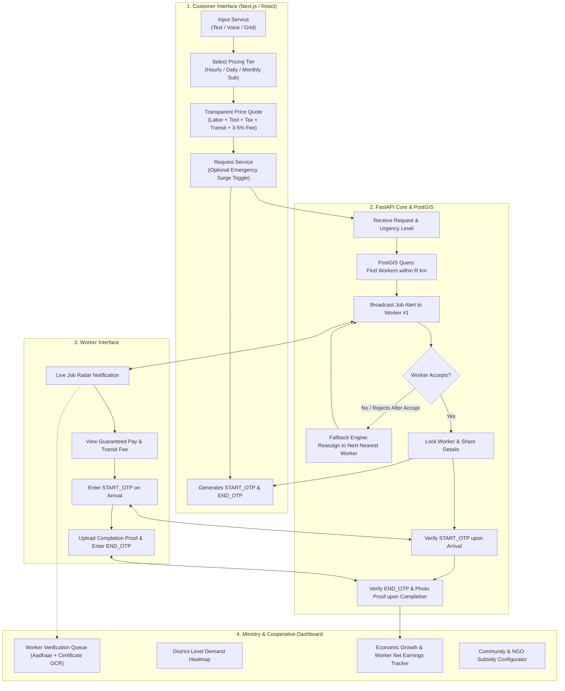

# Implementation Plan: SahakarSeva Prototype (SIH 2026)

This document is the actionable engineering and execution plan to build the prototype of **SahakarSeva**, tailored specifically to your 6-member team's exact skill levels, technical preferences, and SIH deadlines.

---

## 1. Team Role Allocation & Work Division Matrix

| Member | Skillset | Role | Core Responsibilities & Deliverables |
| :--- | :--- | :--- | :--- |
| **You (Lead)** | Basic JS, OOP, API calling | **Frontend Lead (Customer & Worker App)** | • Build Customer UI (text/voice input, category grid, map preview, live OTP display).<br/>• Build Worker Action Drawer (incoming broadcast modal, accept/reject, OTP verification).<br/>• Connect frontend to FastAPI endpoints using `fetch` / `axios`. |
| **Teammate 1** | Basic SQL | **Database Lead (Schemas & PostGIS)** | • Set up PostgreSQL on Supabase or local Docker.<br/>• Enable PostGIS extension and write DDL tables for Users, Workers, Bookings, Credentials.<br/>• Write spatial SQL queries (`ST_DWithin`) to find workers within a radius. |
| **Teammate 2** | Basic SQL | **Data & Analytics Engineer** | • Seed realistic mock data (50+ geo-located workers in Delhi/target city, sample pricing tables, sample trade certificates).<br/>• Write SQL views for the Ministry Dashboard (total worker earnings, active PACS, district demand counts). |
| **Teammate 3** | Basic Python | **Backend Engineer (Core FastAPI & Dispatch Engine)** | • Build FastAPI CRUD endpoints for booking creation, pricing calculation, and status updates.<br/>• Implement the Rapido-style broadcast queue and **fallback reassignment logic** when a worker rejects.<br/>• Implement Dual-OTP generation and verification (`START_OTP`, `END_OTP`). |
| **Teammate 4** | Basic Python | **AI & Integration Engineer (Gemini + Bhashini + Geopy)** | • Integrate **Gemini 1.5 Flash SDK** for instant OCR of Aadhaar & trade certificates.<br/>• Integrate **GeoPy / Haversine formula** to calculate exact distance and transit tariffs.<br/>• Integrate voice/speech recognition (Web Speech API / Bhashini API wrapper). |
| **Teammate 5** | Non-coder | **Product, Presentation & Operations Lead** | • Create UI wireframes (Figma or pencil sketches) for all 3 interfaces.<br/>• Collect sample assets (dummy Aadhaar cards, ITI certificates, service icons).<br/>• Build and polish the 5-slide SIH Pitch Deck using the official templates.<br/>• Manage live demo flow and judge Q&A preparation. |

---

## 2. System Architecture & End-to-End Workflow



---

## 3. Step-by-Step Roadmap: Where & How to Begin

### Phase 0: Setup & Repository Organization (Hours 0 – 6)
* **Step 0.1 (DB Team)**: Create a free project on **Supabase** (it gives PostgreSQL + PostGIS in one click without local DB installation).
* **Step 0.2 (Backend Team)**: Set up a Python virtual environment:
  ```bash
  python -m venv venv
  venv\Scripts\activate
  pip install fastapi uvicorn pydantic geopy google-genai
  ```
* **Step 0.3 (Frontend Team - You)**: Since you know basic JS/OOP, start with **Vite + React** (much simpler to learn and run than Next.js for a hackathon beginner):
  ```bash
  npm create vite@latest sahakar-client -- --template react-ts
  cd sahakar-client
  npm install leaflet react-leaflet lucide-react axios tailwindcss
  ```
* **Step 0.4 (Teammate 5)**: Gather 5 sample certificate images, 5 sample Aadhaar mockups, and prepare the 5-slide PPT deck.

---

### Phase 1: Foundation & Data Layer (Hours 6 – 18)

#### Task 1.1: Database Schema (Teammates 1 & 2)
Enable PostGIS and run the core DDL script:
```sql
CREATE EXTENSION IF NOT EXISTS postgis;

-- 1. Workers
CREATE TABLE workers (
    id SERIAL PRIMARY KEY,
    name VARCHAR(100),
    phone VARCHAR(15),
    skill VARCHAR(50), -- 'plumber', 'electrician', 'driver', 'nursing'
    hourly_rate NUMERIC(8,2),
    daily_rate NUMERIC(8,2),
    monthly_rate NUMERIC(8,2),
    lat DOUBLE PRECISION,
    lng DOUBLE PRECISION,
    geom geometry(Point, 4326),
    is_available BOOLEAN DEFAULT TRUE,
    is_verified BOOLEAN DEFAULT FALSE,
    aadhaar_number VARCHAR(12),
    rating NUMERIC(2,1) DEFAULT 4.8
);

-- 2. Bookings with Dual OTP
CREATE TABLE bookings (
    id SERIAL PRIMARY KEY,
    customer_name VARCHAR(100),
    customer_lat DOUBLE PRECISION,
    customer_lng DOUBLE PRECISION,
    service_type VARCHAR(50),
    pricing_model VARCHAR(20), -- 'hourly', 'daily', 'weekly', 'monthly'
    is_emergency BOOLEAN DEFAULT FALSE,
    is_ngo_discount BOOLEAN DEFAULT FALSE,
    assigned_worker_id INT REFERENCES workers(id),
    status VARCHAR(30) DEFAULT 'BROADCASTING', -- 'BROADCASTING', 'ACCEPTED', 'IN_PROGRESS', 'COMPLETED', 'CANCELLED'
    start_otp VARCHAR(6),
    end_otp VARCHAR(6),
    proof_image_url TEXT,
    labor_cost NUMERIC(8,2),
    toolkit_cost NUMERIC(8,2),
    transit_cost NUMERIC(8,2),
    tax_cost NUMERIC(8,2),
    platform_fee NUMERIC(8,2), -- 3% to 5%
    total_amount NUMERIC(8,2),
    created_at TIMESTAMP DEFAULT NOW()
);
```

#### Task 1.2: Mock Data Seeding (Teammate 2)
Seed 20 workers placed in your target city (e.g., Connaught Place, South Extension, Noida) with coordinates, varied rates, and mock credentials.

---

### Phase 2: Core Backend Engine & Algorithmic Logic (Hours 18 – 36)

#### Task 2.1: Transparent Pricing Engine (Teammate 3)
Build `/api/pricing/calculate` in FastAPI:
* **Hourly**: `Hours * Hourly Rate`
* **Daily**: `Days * Daily Rate (5% discount)`
* **Monthly Subscription**: `Monthly Rate with 15% discount`
* **Breakdown Logic**:
  * $\text{Transit Fee} = \text{Haversine Distance (km)} \times ₹12/\text{km}$
  * $\text{Toolkit Fee} = ₹50 \text{ to } ₹150 \text{ (based on skill)}$
  * $\text{Tax} = 5\% \times \text{Labor Cost}$
  * $\text{Platform Fee} = 3.5\% \times \text{Labor Cost}$ (kept nominal!)
  * $\text{NGO Discount} = -20\% \text{ if } \text{is\_ngo} = \text{true}$
  * $\text{Emergency Premium} = +25\% \text{ surge if } \text{is\_emergency} = \text{true}$

#### Task 2.2: Proximity Query & Fallback Engine (Teammate 3)
```python
# FastAPI Fallback State Machine
@app.post("/api/bookings/{booking_id}/reject")
def worker_reject_job(booking_id: int, worker_id: int):
    # 1. Log worker rejection
    rejected_workers[booking_id].append(worker_id)
    
    # 2. Find next closest worker who hasn't rejected yet
    next_worker = find_next_nearest_worker(booking_id, exclude=rejected_workers[booking_id])
    
    if next_worker:
        # Fallback assignment
        booking.assigned_worker_id = next_worker.id
        booking.status = "BROADCASTING"
        notify_worker(next_worker.id, booking)
        return {"status": "REASSIGNED", "new_worker_id": next_worker.id}
    else:
        booking.status = "NO_WORKERS_AVAILABLE"
        return {"status": "FAILED", "message": "No nearby workers available"}
```

#### Task 2.3: AI OCR & Multilingual Voice (Teammate 4)
* **Certificate OCR**: Use Gemini 1.5 Flash SDK to extract `worker_name`, `skill`, `certificate_id`, and `is_authentic_flag` from uploaded JPG/PDF.
* **Voice Input**: Use the browser's native `webkitSpeechRecognition` (Web Speech API) on the frontend to allow speaking in Hindi or English, passing the text query to the backend.

---

### Phase 3: Frontend Development (Hours 36 – 54)

#### Task 3.1: Customer Portal (You)
* **Header & Multilingual Toggle**: English / Hindi toggle.
* **Input Bar**: Text search + Mic button (Voice to text).
* **Service Cards**: Cleaning, Plumbing, Electrician, Emergency Driver, Elder Care.
* **Pricing Plan Tabs**: `[ Hourly ]` | `[ Daily ]` | `[ Weekly ]` | `[ Monthly Sub (-15%) ]`.
* **Emergency Service Switch**: Toggle for immediate emergency dispatch.
* **Transparent Price Receipt Modal**: Shows the full cost breakdown.
* **Active Booking State**: Displays Map with worker marker, estimated arrival time, and **`START_OTP`** card.

#### Task 3.2: Worker Mobile Dashboard (You)
* **Job Radar Screen**: Sound / notification pop-up showing new job within 3 km with payout amount.
* **Accept / Reject Buttons**: Triggers fallback if rejected.
* **Arrival Screen**: Input box for `START_OTP` (unlocked only when entered).
* **Completion Screen**: Camera upload for Proof-of-Work + input box for `END_OTP`.

---

### Phase 4: Ministry / Government Dashboard & Polish (Hours 54 – 66)

#### Task 4.1: Web-Based Government Portal (You + Teammate 3)
* **National / Regional Metrics**: Total active cooperatives, verified workers, cumulative wages disbursed, total platform savings for citizens.
* **Heatmap / Leaflet Map**: Clusters showing where demand is highest vs. where worker supply is lacking (enabling targeted skill training).
* **Worker Verification Desk**: Review uploaded Aadhaar and trade certificates with Gemini OCR confidence badges (`[✓ Verified ITI Electrician]`).
* **NGO Subsidy Tracker**: Shows discounts given to non-profits and community services.

---

### Phase 5: Demo Prep & Pitch Execution (Hours 66 – 72)
* **Teammate 5**: Finalize PPT slides with real screenshots of your running prototype.
* **Rehearse the Live Script**:
  1. Customer orders an urgent electrician via voice command ("मुझे तुरंत एक इलेक्ट्रीशियन चाहिए").
  2. Show the transparent bill (₹380 total, vs. Urban Company's ₹650).
  3. Worker receives request on phone screen and clicks **Accept**.
  4. Demonstrate fallback: Worker cancels $\rightarrow$ System immediately pushes the job to Worker #2.
  5. Enter `START_OTP` $\rightarrow$ Complete job with photo $\rightarrow$ Enter `END_OTP`.
  6. Switch to Ministry Dashboard: Show the live transaction recorded, welfare fund incremented, and heatmap updated.

---

## 4. Starter Code Snippets & Libraries

### A. Python Backend (`main.py`)
```python
from fastapi import FastAPI
from fastapi.middleware.cors import CORSMiddleware
from pydantic import BaseModel
import random
from geopy.distance import geodesic

app = FastAPI(title="SahakarSeva API")

app.add_middleware(
    CORSMiddleware,
    allow_origins=["*"],
    allow_methods=["*"],
    allow_headers=["*"],
)

class PricingRequest(BaseModel):
    service_type: str
    plan: str # hourly, daily, weekly, monthly
    customer_lat: float
    customer_lng: float
    worker_lat: float
    worker_lng: float
    is_emergency: bool = False
    is_ngo: bool = False

@app.post("/api/pricing/calculate")
def get_pricing(req: PricingRequest):
    base_rates = {"electrician": 250, "plumber": 220, "cleaning": 180, "driver": 300}
    base = base_rates.get(req.service_type.lower(), 200)
    
    # Duration multiplier
    mult = {"hourly": 1, "daily": 7, "weekly": 40, "monthly": 150}.get(req.plan, 1)
    labor_cost = base * mult
    
    # Monthly subscription discount (15%)
    if req.plan == "monthly":
        labor_cost *= 0.85
        
    # Distance & Transit (₹12 per km)
    distance_km = round(geodesic((req.customer_lat, req.customer_lng), (req.worker_lat, req.worker_lng)).km, 1)
    transit_cost = round(max(30.0, distance_km * 12.0), 2)
    
    toolkit_cost = 60.0
    tax = round(labor_cost * 0.05, 2)
    platform_fee = round(labor_cost * 0.035, 2) # Nominal 3.5%
    
    total = labor_cost + toolkit_cost + transit_cost + tax + platform_fee
    
    if req.is_ngo:
        total *= 0.80 # 20% Community discount
    if req.is_emergency:
        total += 100.0 # Emergency priority surcharge
        
    start_otp = str(random.randint(1000, 9999))
    end_otp = str(random.randint(1000, 9999))
    
    return {
        "labor_cost": labor_cost,
        "transit_cost": transit_cost,
        "toolkit_cost": toolkit_cost,
        "tax": tax,
        "platform_fee": platform_fee,
        "total_amount": round(total, 2),
        "distance_km": distance_km,
        "start_otp": start_otp,
        "end_otp": end_otp
    }
```

### B. Frontend Map Component (`MapComponent.tsx` - Leaflet)
```tsx
import React from 'react';
import { MapContainer, TileLayer, Marker, Popup } from 'react-leaflet';
import 'leaflet/dist/leaflet.css';

interface MapProps {
  customerPos: [number, number];
  workerPos: [number, number];
}

export const LiveServiceMap: React.FC<MapProps> = ({ customerPos, workerPos }) => {
  return (
    <div className="h-64 w-full rounded-xl overflow-hidden shadow-md border">
      <MapContainer center={customerPos} zoom={13} style={{ height: '100%', width: '100%' }}>
        <TileLayer
          attribution='&copy; <a href="https://www.openstreetmap.org/copyright">OpenStreetMap</a>'
          url="https://{s}.tile.openstreetmap.org/{z}/{x}/{y}.png"
        />
        <Marker position={customerPos}>
          <Popup>Your Location</Popup>
        </Marker>
        <Marker position={workerPos}>
          <Popup>Assigned Cooperative Worker</Popup>
        </Marker>
      </MapContainer>
    </div>
  );
};
```

---

## 5. Free Resources & Direct Links for Development

| Tool | Purpose | Free Resource / Quickstart URL |
| :--- | :--- | :--- |
| **Supabase** | Instant Hosted PostgreSQL + PostGIS | [supabase.com](https://supabase.com) (Create free account $\rightarrow$ SQL Editor $\rightarrow$ `CREATE EXTENSION postgis;`) |
| **Leaflet.js** | Open-source interactive map without API keys | `npm install leaflet react-leaflet @types/leaflet` |
| **OpenStreetMap** | Free map tiles | `https://{s}.tile.openstreetmap.org/{z}/{x}/{y}.png` |
| **Lucide Icons** | Government & service icons | `npm install lucide-react` |
| **Google GenAI SDK** | Free Gemini 1.5 Flash API key for OCR | [aistudio.google.com](https://aistudio.google.com) |
| **Web Speech API** | Free voice recognition in browser | Native JavaScript `window.webkitSpeechRecognition` (Zero install needed!) |
| **Tailwind CSS** | Styling for fast prototyping | `npx tailwindcss init -p` |
